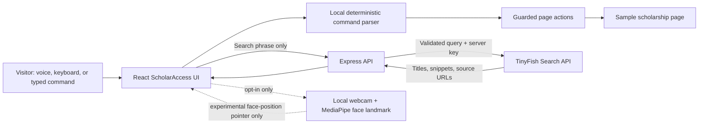

# ScholarAccess — AZINHACK 2026

**Find the support to go further.** ScholarAccess is an accessibility-first scholarship discovery demo. It combines voice and typed navigation over a sample scholarship page with live web search powered by the TinyFish Search API.

> This project contains a fictional scholarship and local-only sample application. Live search results come from the web and must be verified with each official provider.

## Why this project

Finding financial support online can mean navigating long pages, unfamiliar language, and scattered sources. ScholarAccess demonstrates a more approachable experience: visitors can search for current opportunities and use voice, typing, or keyboard navigation to find and understand the information on the page.

## What works

- Responsive scholarship discovery interface with semantic headings, labels, keyboard focus, and high-contrast controls.
- Server-side TinyFish Search API integration for fresh scholarship searches. Only the search phrase is sent to TinyFish; the API key never reaches the browser.
- Deterministic offline command handling for `find`, `read`, `explain`, `scroll`, `stop`, and help. Ambiguous requests are not allowed to pick a random action target.
- Typed commands work in all supported browsers. Browser speech recognition (`en-IN`) and speech synthesis are used when available.
- Page-grounded read-aloud and plain-language explanation for the explicitly fictional sample scholarship.
- Local-only demo form with a confirmation step. No form details are sent or stored.
- Optional MediaPipe face-landmark pointer, loaded only after the visitor enables the camera. The model and WebAssembly runtime are downloaded from their public CDN when enabled.
- Stop cancels speech and pending live searches; late search responses are ignored by the UI.
- Clear local demo/search status and responsive fallbacks for unavailable permissions or browser APIs.

## Experimental and incomplete

- **Camera pointer is not eye-gaze tracking.** It maps approximate face/nose movement to a screen pointer after a simple center calibration. Accuracy has not been validated across devices or users. The pointer cannot click, activate controls, or submit the form.
- Camera use needs an explicit opt-in and a secure context (`localhost` is allowed). Camera footage is processed in the browser and is not uploaded by this app. The MediaPipe model/WASM files are downloaded from external CDNs after enabling the camera.
- Speech recognition support depends on the browser and may use browser-vendor services. If it is unavailable or permission is denied, type commands instead.
- TinyFish live search needs an API key. Without one, the UI clearly reports that live search is not connected; it does not pretend a real search succeeded.
- Live listings are search-engine results, not verified scholarship offers. Follow the result to its provider and verify eligibility, dates, and terms.
- There is no LLM command-resolution endpoint: commands use a small, transparent local intent parser. TinyFish is integrated meaningfully for current web discovery.

## Technology

- React 19, TypeScript, Vite, and responsive CSS
- Express 5, TypeScript, Zod, and Node's `fetch`
- TinyFish Search API (`GET https://api.search.tinyfish.ai`, authenticated with the `X-API-Key` header)
- Web Speech API (browser support dependent)
- MediaPipe Tasks Vision Face Landmarker (opt-in experimental pointer)
- Vitest

## Prerequisites

- Node.js 20 or newer
- npm
- (Optional) TinyFish API key from [agent.tinyfish.ai/api-keys](https://agent.tinyfish.ai/api-keys)

## Run locally

From the project root:

```bash
npm install
```

Copy `.env.example` to `.env` and optionally add your server-side TinyFish key:

```dotenv
PORT=3001
CLIENT_ORIGIN=http://localhost:5173
TINYFISH_API_KEY=your_key_here
```

Start the frontend and backend together:

```bash
npm run dev
```

Open **http://localhost:5173**. The Vite development server proxies `/api` requests to the Express server at port 3001. The backend health check is at **http://localhost:3001/api/health**.

No TinyFish key is required for the page, local commands, reading, explanation, or demo form. Live search will display an explicit offline message until a key is configured. Never put the key in a `VITE_` variable or client source.

Other commands:

```bash
npm test       # focused command-parser tests
npm run build  # TypeScript checks and production frontend build
npm run start  # run the API server (requires dependencies installed)
```

For a production deployment, host the static `dist/` frontend and Express API together or configure your host to route `/api` to the server. Set `CLIENT_ORIGIN` to the actual frontend origin.

## TinyFish integration

The search box sends the visitor's query to `GET /api/scholarships/search?q=...`. The Express server validates its length, sends the query to TinyFish's Search endpoint with `X-API-Key`, and returns a small normalized set of titles, snippets, and HTTP(S) source links. The browser never sees the credential. TinyFish search results make the product useful for finding current opportunities; this is more than a decorative mention. An absent key produces an explicitly labeled offline state; upstream errors are shown rather than replaced with fake live results.

## Architecture



## Demo walkthrough (2–3 minutes)

1. Open the app and explain that scholarship information is fragmented and may be difficult to navigate.
2. Use the search box with “engineering scholarships for women in India”. With `TINYFISH_API_KEY` configured, show results labeled **LIVE · TINYFISH**, open a source, and explain that the provider remains the authority. Without a key, show the honest offline message.
3. Type **Find the registration form** into the assistant or click its suggested command. Show the page scroll and highlight the sample form.
4. Type **Read the eligibility criteria**. The browser reads the visible fictional eligibility text aloud (speech output depends on browser settings).
5. Type **Explain this in simple words** and show the grounded explanation. Point out that it repeats only the clearly labeled sample facts.
6. Start the demo form and show the confirmation dialog. Confirm to demonstrate local completion, then note that no information was sent.
7. If time and a secure browser context permit, opt in to the camera. The face-position cursor is only an experiment—not reliable eye gaze—and cannot click. Show the recalibration control, then turn the camera off.
8. Press **Stop** and demonstrate the text-command fallback. Mention that Stop cancels speech and outstanding search work.

## Privacy and safety

- The sample application never submits information; confirmation only updates local UI state.
- Camera access is requested only after the visitor opts in. Disable it to stop its media tracks.
- A TinyFish key belongs in the backend `.env` only. Do not commit `.env`.
- Only the search query is sent to TinyFish; search result content is external and untrusted.
- Speech and camera availability/processing can depend on browser implementation and permissions.
- No payment, real application submission, external message sending, or arbitrary webpage action is implemented.

## Team contributions (1–4 people)

- **Accessibility & UX:** test keyboard-only flows, screen-reader labels, contrast, and command wording.
- **TinyFish & backend:** test live search, error handling, result quality, and deployment configuration.
- **Frontend & demo:** improve responsive behavior, verify sample content, record the demo, and check the public links.
- **Testing & research:** independently verify scholarship listings with official sources and test supported browsers.

## Submission checklist

- [ ] Configure TinyFish key and record a live search working in the demo.
- [ ] Publish the repository as public and test its README/install instructions on a clean checkout.
- [ ] Record a 2–3 minute demo that visibly includes TinyFish search.
- [ ] Publish a public project post with the repository and demo link.
- [ ] Submit the repository, demo video, and social post through Unstop before the deadline.
